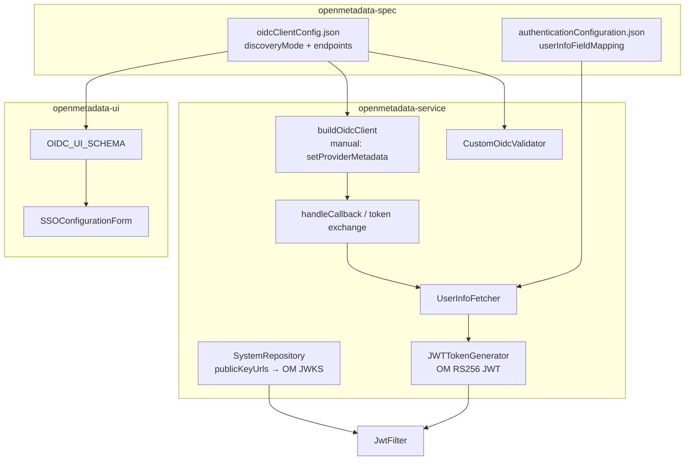
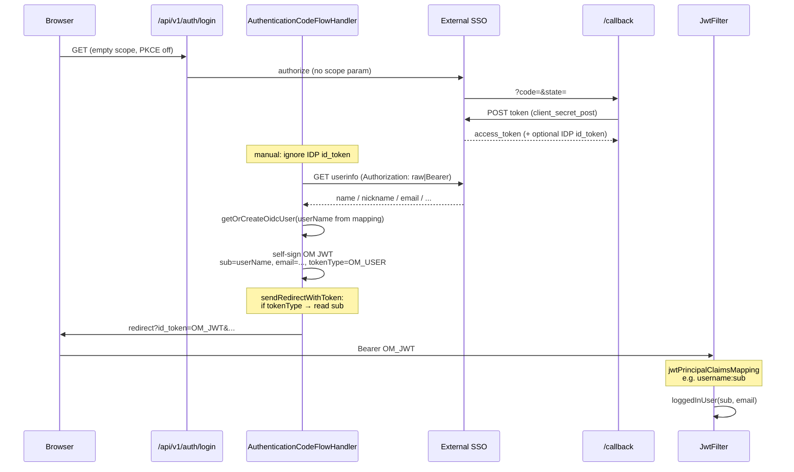

# Custom OIDC Manual Discovery Mode - Design Document

## 1. Overview

### 1.1 Purpose

Extend OpenMetadata Custom OIDC so administrators can configure OAuth2/OIDC endpoints **manually** (`discoveryMode: manual`), without requiring `/.well-known/openid-configuration`. This enables integration with IDPs that:

- Have no discovery document and no JWKS
- Return opaque (or non-OM-verifiable) access / id tokens
- Expose user identity only via a **userinfo** endpoint
- Align with lakeinsight-style field mapping (`name_field` / `display_name_field` / `uid_field`)

### 1.2 Background

Stock Custom OIDC always resolves endpoints via discovery (`OidcConfiguration.setDiscoveryURI` → HTTP GET well-known). Validators also require a derivable discovery URI.

Production target (custom SSO / lakeinsight-compatible OAuth):

| Capability | Stock OM Custom OIDC | Target IDP |
|------------|----------------------|------------|
| Discovery | Required | None |
| JWKS | From discovery / publicKeyUrls | None usable for OM JwtFilter |
| Token | Expects JWT id_token | Opaque access_token; may also return ES256 id_token |
| User identity | id_token claims | userinfo JSON fields |
| Scope | Often `openid` | Must be **empty** (rejects `openid`) |
| PKCE | Default on | Must be **disabled** |
| userinfo `Authorization` | Bearer | **raw** token (no `Bearer` prefix) |

Reference: lakeinsight `AuthOauth` (`type=1`) — code exchange → userinfo with raw header → map fields → local session.

### 1.3 Goals

1. Add `discoveryMode: auto | manual` (default `auto`, backward compatible).
2. Manual mode: inject `OIDCProviderMetadata` with explicit authorize / token / userinfo / logout endpoints.
3. Manual mode: fetch userinfo, map fields, **always** issue an OpenMetadata RS256 JWT for the browser.
4. Support empty scope, PKCE off, raw userinfo header, and pre-synced users (`User.name` ≠ email local-part).
5. On SSO save, force `publicKeyUrls` to OM JWKS in manual mode.
6. UI: toggle discovery mode and show the right fields; docs + Playwright coverage.

### 1.4 Non-Goals

- Changing `JwtFilter` claim resolution for all providers (keep `jwtPrincipalClaims` / `jwtPrincipalClaimsMapping` flexible; production uses config hot-fix).
- Fixing Organization team hierarchy WARN noise (false positive; does not block login).
- Persisting RSA key files across image rolls (ops follow-up).
- Replacing lakeinsight user sync; OM only consumes already-synced `User.name` / `displayName`.

---

## 2. Design Principles

1. **Schema-first** — JSON Schema is the source of truth; Java / TS / UI forms are generated or RJSF-driven.
2. **Backward compatible** — missing `discoveryMode` means `auto`; existing Custom OIDC installs unchanged.
3. **OM owns API auth tokens in manual mode** — never rely on IDP id_token for JwtFilter.
4. **Config over hard-coding for claim consumption** — JwtFilter still driven by SSO settings; redirect path may special-case OM-signed JWTs (`tokenType` present).
5. **Align with lakeinsight field mapping** — direct `userinfo.get(field)` style extraction.

---

## 3. Architecture

### 3.1 Layers



### 3.2 Login sequence (manual + production hardening)



---

## 4. Schema Design

### 4.1 `oidcClientConfig.json`

| Field | Type | Notes |
|-------|------|--------|
| `discoveryMode` | `auto` \| `manual` | Default `auto` |
| `discoveryUri` | string | Required when `auto` |
| `issuer` | string | Manual metadata issuer |
| `authorizationEndpoint` | string | Required when `manual` |
| `tokenEndpoint` | string | Required when `manual` |
| `userInfoEndpoint` | string | Required when `manual` |
| `logoutEndpoint` | string | Optional |
| `jwksUri` | string | Optional; **not** used to fill publicKeyUrls in final design |
| `userInfoTokenHeaderType` | `bearer` \| `raw` | Default `bearer` |

Conditional `required` via JSON Schema `if` / `then` / `else` on `discoveryMode`.

### 4.2 `authenticationConfiguration.json`

**`userInfoFieldMapping`** (manual):

| Property | lakeinsight analog | Use |
|----------|-------------------|-----|
| `userNameField` | `name_field` | → `User.name` lookup key |
| `displayNameField` | `display_name_field` | → `User.displayName` backfill |
| `emailField` | (OM-specific) | → `User.email` |
| `userIdField` | `uid_field` | Reference / logging only |

**`displayNameClaim`** (auto only): claim name in id_token for display name.

Example (external IdP / lakeinsight-style sync):

```yaml
userInfoFieldMapping:
  userNameField: name
  displayNameField: nickname
  emailField: email
  userIdField: sub
```

---

## 5. Backend Design

### 5.1 `buildOidcClient` — manual metadata

When `discoveryMode == manual`, build Nimbus `OIDCProviderMetadata` (issuer, authorize, token, userinfo, logout, grant types, token auth method) and `configuration.setProviderMetadata(metadata)`. Skip discovery HTTP.

### 5.2 `UserInfoFetcher`

- GET `userInfoEndpoint` with `Authorization: Bearer <token>` or raw `<token>`.
- Read fields by configured names; return `UserInfoResult(userName, email, displayName, userId)`.

### 5.3 Callback — always OM JWT in manual mode

**Final behavior (stricter than early draft):**

```text
executeAuthorizationCodeTokenRequest:
  populate credentials from token response
  if manual:
    handleManualModeUserInfo(credentials)  // userinfo + self-sign
    return
  // auto: require id_token, existing path
```

Rationale: IDP may return an ES256 (or otherwise unverifiable) id_token; forwarding it breaks JwtFilter. Manual mode always replaces `credentials.idToken` with an OM-signed JWT (`ServiceTokenType.OM_USER`).

`handleManualModeUserInfo`:

1. Fetch userinfo.
2. Build claims (`username`, `email`, optional displayName field).
3. `getOrCreateOidcUser` (lookup by `User.name`; backfill empty `displayName`).
4. `JWTTokenGenerator.generateJWTToken(...)` → `credentials.setIdToken(...)`.

### 5.4 Empty scope authorization URL

Nimbus `AuthenticationRequest` requires scope. Some IDPs reject `openid`.

- `buildLoginParams`: omit scope key when blank.
- `toAuthorizationQueryString`: if scope present, use Nimbus; else manual URL-encode join.
- Validator token probe: do **not** default-append `scope=openid`.

### 5.5 Refresh path (session reuse)

On refresh token response that includes `id_token`, after populate:

```text
if (isManualDiscoveryMode()) {
  handleManualModeUserInfo(credentials);
}
```

Prevents IDP id_token from overwriting the OM JWT when `/auth/login` reuses the session.

### 5.6 `sendRedirectWithToken` — OM JWT awareness

After self-sign, redirect must not re-derive username via `jwtPrincipalClaims` with `email` first (would turn `alert@example.com` into user `alert` while DB user is `u8f3a2c1`).

```text
if claims contain tokenType:  // OM-issued
  userName = sub | username | preferred_username
  email    = email claim
else:
  findUserNameFromClaims / findEmailFromClaims
```

### 5.7 Nonce

Skip nonce validation when `tokenType` is present (OM JWT has no nonce).

### 5.8 `publicKeyUrls` auto-populate

**Final behavior:**

- Manual + `serverUrl` set → always  
  `{serverUrl}/api/v1/system/config/jwks`  
  (do **not** use IDP `jwksUri`).
- `SystemResource` calls `autoPopulatePublicKeyUrlsIfNeeded` before persisting security settings.

### 5.9 Validators

- Manual: require authorize / token / userinfo; confidential clients need id + secret; skip discovery validator.
- Auto: unchanged discovery path.

### 5.10 Display name

- Extend `SecurityUtil.extractDisplayNameFromClaims` with `nickname` (and optional `displayNameClaim` for auto).
- Manual: prefer `UserInfoResult.displayName` for backfill when DB `displayName` empty.

---

## 6. Frontend Design

- `discoveryMode` control; show manual endpoints + `userInfoFieldMapping` when `manual`; show `discoveryUri` / `displayNameClaim` when `auto`.
- i18n keys (en / zh).
- Operator doc: `customOidcSSOClientConfig.md`.
- Playwright: SSO configuration coverage for manual fields.

---

## 7. Production hardening vs original draft

| Topic | Early draft | Shipped behavior |
|-------|-------------|------------------|
| When to self-sign | Only if id_token missing | **Always** in manual mode |
| publicKeyUrls | Optional IDP jwksUri | **Always** OM JWKS |
| Scope | Assumed openid OK | Empty scope supported |
| Refresh | Not specified | Re-run manual userinfo + self-sign |
| Redirect username | Via jwtPrincipalClaims | OM JWT → read `sub` |
| JwtFilter | Unchanged | Unchanged; use **config** `username:sub` |

---

## 8. Recommended production config (example)

```yaml
provider: custom-oidc
clientType: confidential
oidcConfiguration:
  discoveryMode: manual
  scope: ""
  disablePkce: true
  clientAuthenticationMethod: client_secret_post
  userInfoTokenHeaderType: raw
  authorizationEndpoint: https://sso.ssoprovider.com/oauth2/authorize
  tokenEndpoint: https://sso.ssoprovider.com/oauth2/token
  userInfoEndpoint: https://sso.ssoprovider.com/oauth2/userinfo
  callbackUrl: https://metadata.open-metadata.org/callback
  serverUrl: https://metadata.open-metadata.org
userInfoFieldMapping:
  userNameField: name
  displayNameField: nickname
  emailField: email
  userIdField: sub
publicKeyUrls:
  - https://metadata.open-metadata.org/api/v1/system/config/jwks
jwtPrincipalClaimsMapping:
  - username:sub
  - email:email
principalDomain: open-metadata.org
```

`jwtPrincipalClaimsMapping` is required when `User.name` ≠ email local-part (e.g. synced id `u8f3a2c1` with email `alert@example.com`). Without it, JwtFilter may resolve username from `email` and `loggedInUser` returns “Account already exists”.

---

## 9. Implementation map

| Area | Path |
|------|------|
| Schema | `openmetadata-spec/.../oidcClientConfig.json`, `authenticationConfiguration.json` |
| Handler | `.../security/AuthenticationCodeFlowHandler.java` |
| Userinfo | `.../security/UserInfoFetcher.java` |
| Display name | `.../security/SecurityUtil.java` |
| Validator | `.../auth/validator/CustomOidcValidator.java` |
| publicKeyUrls | `.../jdbi3/SystemRepository.java`, `.../resources/system/SystemResource.java` |
| Tests | `AuthenticationCodeFlowHandlerManualTest`, `AuthenticationCodeFlowHandlerScopeTest`, `CustomOidcManualValidatorTest` |
| UI | `SSO.constant.ts`, `SSOConfigurationForm.tsx`, `SSOUtils.ts`, locales, Playwright |

---

## 10. Known follow-ups

| Item | Notes |
|------|--------|
| Optional JwtFilter OM-JWT shortcut | Mirror redirect `tokenType` → `sub` for zero-config; traded off for claim-mapping flexibility |
| Organization circular WARN | False positive when user in multiple groups under Organization |
| JWT key file persistence | Mount stable `public_key.der` / `private_key.der` so bot tokens survive image rolls |
| Bot token Fernet vs external readers | Prefer Secret/env plaintext JWT for collectors that read DB |

---

## 11. Testing notes

- Unit: empty-scope query string; manual validator; manual `validateConfig` metadata.
- E2E: SSO form discoveryMode toggle and field visibility.
- Production smoke: SSO login for user with `name ≠ email` prefix; decode redirect `id_token` (`alg=RS256`, `tokenType=OM_USER`, `sub=<User.name>`); `loggedInUser` 200.
